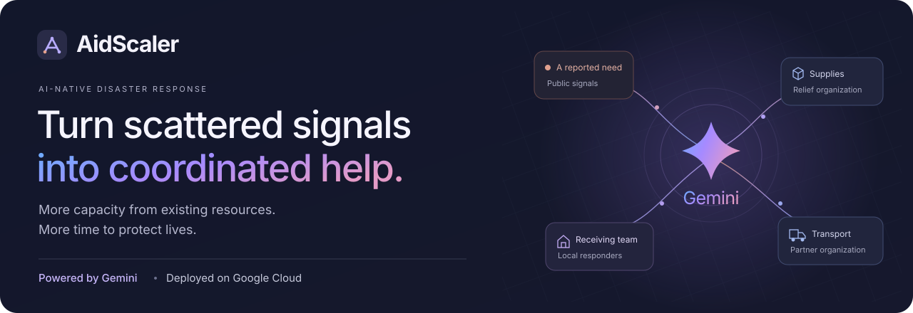

<p align="center">
  
</p>

<p align="center">
  <a href="https://aidscaler.com/"><strong>Explore AidScaler</strong></a> ·
  <a href="https://aidscaler.com/demo/"><strong>Try the demo</strong></a> ·
  <a href="docs/ARCHITECTURE.md">Architecture</a> ·
  <a href="docs/BENCHMARK.md">Results</a> ·
  <a href="deploy/gcp/README.md">Google Cloud</a>
</p>

# AidScaler

**An AI-native operations platform for disaster response.** AidScaler helps NGOs, emergency services and public response teams turn scattered social posts, news, field reports and operational data into coordinated help. The platform is deployed on **Google Cloud**, with **Gemini on Vertex AI** integrated into its investigation and response workflows.

In a disaster, a need may appear in a community post, available supplies in another team's inventory, and transport capacity in a driver's voice note. AidScaler connects those fragments, checks what can actually work and prepares a response that people can authorize and follow through to receipt.

**More capacity from existing resources. More time to protect lives.**

## What makes it different

**One organization becomes more capable. Connected organizations unlock responses none could complete alone.**

Consider a shelter requesting water. One team has supplies. A second reports, “We're returning empty at 10:30.” A third can receive the delivery. Gemini interprets the report as potential transport capacity, investigates stock, vehicle capacity, routes, timing and partner consent, then prepares a coordinated response with evidence attached.

The result is an actionable plan: **who contributes what, which steps depend on each other, who must approve, and how completion will be confirmed.** Every organization retains control of its own resources.

## Measured impact

| Outcome                         | Conventional response | AidScaler + Gemini |                       Improvement |
| :------------------------------ | --------------------: | -----------------: | --------------------------------: |
| Average wait for sufficient aid |             45.22 min |      **33.98 min** |           **24.85% less waiting** |
| Average time to authorization   |             28.60 min |      **18.92 min** |              **33.84% less time** |
| Human coordination effort       |        263 person-min |  **16 person-min** | **93.92% less coordination work** |
| Needs fully served              |               24 / 24 |        **24 / 24** |      **Full coverage maintained** |

<sub>Paired simulation · 18 October 2026 · Takamatsu, Japan · four organizations · Gemini 3.8 Flash on Vertex AI. Human effort is modeled; aid completion includes travel, unloading and physical receipt.</sub>

[How we measured this →](docs/BENCHMARK.md) · [Explore the independent simulator →](https://github.com/Hi-io/disaster-response-simulator)

## From a signal to help received

| Stage                    | What AidScaler does                                                                                                                                                       |
| :----------------------- | :------------------------------------------------------------------------------------------------------------------------------------------------------------------------ |
| **Understand**           | Interpret public reports, images, voice notes, documents and connected records. Preserve sources, revisions and supporting evidence.                                      |
| **Investigate**          | Use Gemini and scoped tools to connect claims with current needs, available resources and operational constraints. Request clarification or field assessment when needed. |
| **Coordinate**           | Combine supplies, transport, facilities and qualified people across teams. Prepare feasible responses with quantities, dependencies and responsible owners.               |
| **Authorize**            | Give each resource owner a clear review of the proposed contribution, evidence and conditions. People approve the exact response version.                                 |
| **Deliver and adapt**    | Track dispatch, movement, receipt and service. Revisit affected steps when access, availability or conditions change.                                                     |
| **Keep people informed** | Publish approved needs and progress through an organization-owned public portal, with community reporting and follow-up.                                                  |

Gemini's activity is visible through **tool calls, evidence, checks and findings**. Operators can inspect how a proposal is supported while keeping their attention on the next decision.

## One platform, focused workspaces

| Who uses it                       | Their experience                                                                                                      |
| :-------------------------------- | :-------------------------------------------------------------------------------------------------------------------- |
| **Response coordinators**         | Priorities, resources, a decision queue and an operational map. Review a response, authorize it and follow execution. |
| **Analysts**                      | Source feeds, linked evidence, investigations and clarification requests.                                             |
| **Field teams**                   | Assigned tasks, mobile reporting, delivery confirmation and offline report synchronization.                           |
| **Partner organizations**         | Share selected capabilities and coordinate contributions with separate ownership and approval.                        |
| **Communities and supporters**    | Report a need, follow its updates and see approved public progress.                                                   |
| **Administrators and publishers** | Manage access and integrations, review publications and inspect the audit trail.                                      |

## Built on Google Cloud

The web application, API, operational records and evidence storage run on Google Cloud. Gemini connects interpretation and investigation to the platform's operational tools.

| Technology                                      | Role in AidScaler                                                                                |
| :---------------------------------------------- | :----------------------------------------------------------------------------------------------- |
| **Gemini on Vertex AI**                         | Interpret unstructured information, investigate possibilities and call scoped operational tools. |
| **Firebase Hosting**                            | Deliver the web experience over HTTPS and route application requests to Cloud Run.               |
| **Cloud Run**                                   | Host the platform API, workspaces and bounded agent workflows.                                   |
| **Cloud SQL · PostgreSQL**                      | Persist organizational records, evidence references, decisions, jobs and execution history.      |
| **Cloud Storage**                               | Store evidence attachments privately.                                                            |
| **Pub/Sub + Cloud Tasks**                       | Exchange asynchronous events and schedule durable work and retries.                              |
| **IAM + Secret Manager**                        | Scope service access and protect runtime credentials.                                            |
| **Cloud Build + Artifact Registry + Terraform** | Build versioned releases and define repeatable infrastructure.                                   |

[Explore the architecture →](docs/ARCHITECTURE.md) · [Google Cloud deployment →](deploy/gcp/README.md)

## Explore the code

| Start here                                      | What you will find                                                                   |
| :---------------------------------------------- | :----------------------------------------------------------------------------------- |
| [Architecture](docs/ARCHITECTURE.md)            | Agent workflow, operational contracts, organization boundaries and code map.         |
| [Integrations](docs/INTEGRATIONS.md)            | Public sources, HTTP and MCP connectors, media and partner coordination.             |
| [Benchmark](docs/BENCHMARK.md)                  | Measured outcomes, scenario design, metric definitions and machine-readable results. |
| [Development guide](docs/LOCAL.md)              | Installation, the evaluation laboratory, role-based walkthrough and checks.          |
| [Google Cloud deployment](deploy/gcp/README.md) | Service responsibilities, Gemini configuration and release workflow.                 |

For a development checkout, use **Node.js 24+** and **pnpm 11**:

```sh
git clone https://github.com/Hi-io/aidscaler-platform.git
cd aidscaler-platform
pnpm install --frozen-lockfile
pnpm check
```

The [development guide](docs/LOCAL.md) covers running the workspaces and tests. The [disaster-response simulator](https://github.com/Hi-io/disaster-response-simulator) is a separate evaluation project that supplies repeatable scenarios and physical outcomes.

---

**See the response come together.** [Explore AidScaler](https://aidscaler.com/) or [try the interactive demo](https://aidscaler.com/demo/).
