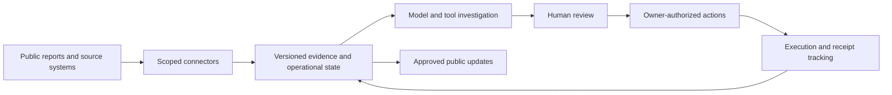

# AidScaler local architecture

AidScaler is a Node.js application with a browser workspace, persistent operational records and scoped integrations. The local laboratory runs multiple organizations against one independently controlled disaster world.

## Components

| Area | Responsibility |
|---|---|
| `server.mjs` | HTTP endpoints, sessions, role permissions and organization workspace |
| `src/` | Operational contracts, investigations, integrations, evidence, network coordination and persistence |
| `ui/` | Operator workspace, public portal, field reporting and offline shell |
| `evaluation/` | Scenario controllers and measurements based on physical source receipts |
| `scripts/` | Laboratory launcher, setup, demonstrations, checks and local experiment tools |
| `tests/` | Local contracts, authorization, integration and recovery checks |

The default database is PostgreSQL-compatible PGlite in an ignored local directory. `DATABASE_URL` connects to an external PostgreSQL server. Evidence bytes are stored separately from operational records.

## Model layer

The current provider is OpenRouter with `google/gemma-4-31b-it`. The backend gives investigations focused context, then retrieves additional information through scoped tools. Model output is validated against action contracts and current dependencies. The model cannot authorize physical execution.

Budgets, call limits and timeouts are configured locally. Automatic ingestion and automatic investigation are separate settings. Tool activity is observable through returned evidence and operational progress.

## Organization boundaries

Each organization has its own accounts, database and source credentials. Signed exchanges carry selected observations, capabilities and commitments. The resource owner retains approval; the coordinator cannot silently spend another organization's stock or fleet.

The simulator owns world time, physics and authoritative receipts. Its observer UI is an evaluation surface, not a source of privileged model context. Approval, dispatch, arrival, unloading and useful service remain separate events.

## Local lab and future deployment

`pnpm lab` starts the simulator gateway, four operational workspaces and an independent partner. Servers bind to loopback. The public portal shows only reviewed, approved aggregates; payments are a local sandbox.

Gemini and Google Cloud are planned integrations. The checked-in runtime is local; this repository does not represent a deployed Cloud Run, Firebase or Cloud SQL installation.

See [local operation](LOCAL.md) and [integrations](INTEGRATIONS.md) for the available setup and boundaries.
