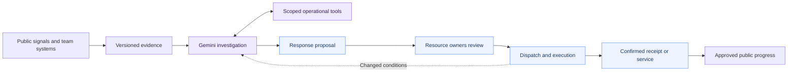
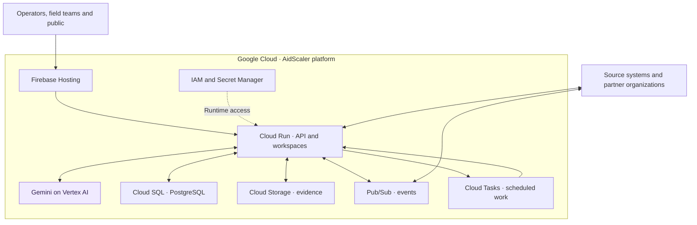

# AidScaler architecture

[Overview](../README.md) · [Google Cloud deployment](../deploy/gcp/README.md) · [Integrations](INTEGRATIONS.md) · [Benchmark](BENCHMARK.md)

AidScaler connects information, decisions and execution in one disaster-response workspace. Gemini interprets unstructured information and investigates possibilities; operational contracts turn those possibilities into accountable, owner-authorized actions.

## The response lifecycle

**Interpretation, feasibility and authority are distinct responsibilities.** Gemini discovers useful opportunities in everyday reports. Tools inspect current facts and constraints. Resource owners approve commitments. Execution records establish what happened.

## How Gemini investigates

The [investigation engine](../src/investigation.mjs) runs a bounded model/tool loop:

1. **Establish the case.** Begin with the organization's received information, relevant evidence and current operational context.
2. **Ask targeted questions.** Retrieve stock, reserves, vehicle capacity, shifts, staff qualifications, access, facilities and partner capabilities through scoped tools.
3. **Resolve dependencies.** Cross-check a claim, request clarification or prepare a field assessment. Resume when a pending answer arrives.
4. **Develop a feasible response.** Prepare allocations, services, repairs or assessments using concrete records, quantities, owners and dependencies.
5. **Present it for review.** Attach the evidence and checks to a versioned proposal. Each owner authorizes its own contribution.
6. **Revisit what changes.** Use new observations and execution receipts to repair affected parts of an existing response.

Checkpoints preserve progress, tool results and usage. Call limits, timeouts and spending reservations bound each investigation. The activity view exposes tool requests, returned evidence and findings so operators can follow the work.

The [Vertex AI adapter](../src/vertex-provider.mjs) implements Gemini text and image input, function calls, function responses, authenticated requests and token accounting. It preserves the provider's opaque tool-call signatures across turns. [Adapter tests](../tests/vertex-provider.test.mjs) exercise request and response conversion.

Gemini and the deterministic response checks have complementary roles: the model interprets meaning and explores options; the domain and execution layers enforce quantities, current versions, ownership and valid transitions.

## Google Cloud service architecture

Firebase Hosting serves web assets and forwards dynamic requests to Cloud Run. Cloud SQL stores durable operational state; Cloud Storage holds private attachment bytes. Cloud Tasks schedules work, while Pub/Sub transports asynchronous source and command events. Service identities and Secret Manager control access.

The simulator is an **external evaluation source**, with its own repository and world engine. Its physical state and observer view remain separate from the platform's authorized inputs. See the [benchmark methodology](BENCHMARK.md).

## Connected organizations

Each organization has a scoped workspace, accounts, capabilities and decision authority. The network layer exchanges selected observations, offers and commitments using signed messages.

A joint response can combine one team's supplies, another's vehicle and a local receiving team. Each contribution remains associated with its owner, its permission and its current version. Changes to an offer or reservation can invalidate a dependent step and trigger a new review.

The same boundary supports separately operated deployments: exchange permitted needs and capabilities through APIs and signed partner links while retaining each organization's operational records and policies.

## Durable execution

- **Evidence:** retain originals, revisions, source references and links supporting a claim or proposal.
- **Review:** authorize the exact proposal version and the owner's contribution.
- **Resources:** enforce stock, protected reserves, reservations, vehicle capacity, qualified staff and availability.
- **Execution:** preserve command identity across retries and track dispatch, travel, unloading, receipt and useful service separately.
- **Recovery:** resume durable work and revisit stale dependencies without duplicating an existing commitment.
- **Public communication:** publish reviewed progress through a separate public projection.

## Code map

| Area                                                    | Responsibility                                                                                 |
| ------------------------------------------------------- | ---------------------------------------------------------------------------------------------- |
| [`server.mjs`](../server.mjs)                           | HTTP API, sessions, role permissions and workspace assembly.                                   |
| [`src/investigation.mjs`](../src/investigation.mjs)     | Model/tool investigation loop and response preparation.                                        |
| [`src/vertex-provider.mjs`](../src/vertex-provider.mjs) | Gemini on Vertex AI.                                                                           |
| [`src/domain.mjs`](../src/domain.mjs)                   | Operational records, action contracts and transitions.                                         |
| [`src/store.mjs`](../src/store.mjs)                     | PostgreSQL-backed persistence and transactions.                                                |
| [`src/network.mjs`](../src/network.mjs)                 | Signed, scoped coordination between organizations.                                             |
| [`src/integrations.mjs`](../src/integrations.mjs)       | External HTTP and MCP source connections.                                                      |
| [`ui/`](../ui/)                                         | Operator workspace, field experience, public portal and offline shell.                         |
| [`scripts/gcp-server.mjs`](../scripts/gcp-server.mjs)   | Cloud Run gateway, provider selection and managed work scheduling.                             |
| [`deploy/gcp/`](../deploy/gcp/)                         | Terraform, container builds, Hosting publication and release utilities.                        |
| [`evaluation/`](../evaluation/)                         | Scenario controllers, physical outcome traces and measurements.                                |
| [`tests/`](../tests/)                                   | Contracts, ownership, agent activity, delivery, recovery, cloud adapters and browser behavior. |

The [development guide](LOCAL.md) explains the embedded PostgreSQL-compatible development store and the evaluation laboratory. The deployed platform uses Cloud SQL.
